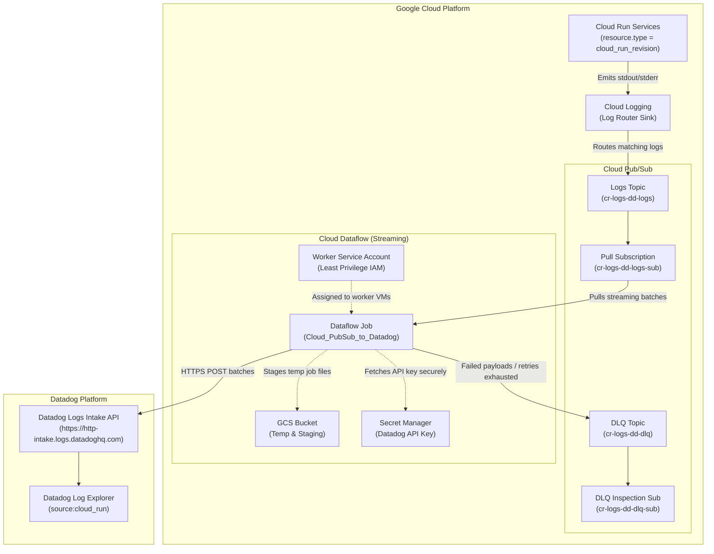

# Production-Grade Cloud Run Log Routing to Datadog via Terraform

This repository provides an enterprise, production-ready Terraform configuration for routing Google Cloud Run logs to **Datadog** using Google Cloud Logging, Pub/Sub, Secret Manager, Cloud Storage, and Google Cloud Dataflow.

It adapts and modernizes the architecture described in [Divya Khatnar's article ("Google Cloud Run logs to Splunk")](https://divyakhatnar.medium.com/google-cloud-run-logs-to-splunk-10924d937525) for **Datadog**, adhering to Google Cloud and Datadog enterprise reliability and security standards.

---

## 1. Architecture Overview

### Comparison: Splunk (Article) vs. Datadog (This Repository)

| Dimension | Divya Khatnar's Splunk Setup | Datadog Production Setup (This Module) |
|---|---|---|
| **Source** | Google Cloud Run revisions | Google Cloud Run revisions (and optional Jobs) |
| **Log Router Sink** | Cloud Logging Sink with filter `resource.type="cloud_run_revision"` | Cloud Logging Sink with dynamic filtering, severity threshold, and dedicated writer identity |
| **Buffer** | Cloud Pub/Sub Topic | Cloud Pub/Sub Topic + Dedicated Dead-Letter Queue (DLQ) |
| **Processing Engine** | Dataflow (`Cloud_PubSub_to_Splunk`) | Dataflow (`gs://dataflow-templates/latest/Cloud_PubSub_to_Datadog`) |
| **Destination** | Splunk HTTP Event Collector (HEC) | Datadog Logs HTTP Intake API (`https://http-intake.logs.<site>`) |
| **Credential Security** | Plaintext / KMS parameter | Google Secret Manager (`SECRET_MANAGER` integration) |
| **IAM Model** | Broad IAM roles | Least-privilege, resource-level IAM bindings |
| **Reliability** | Basic template error routing | Pub/Sub DLQ topic + inspection subscription + drain on delete |

---

### End-to-End Architecture Flow



---

## 2. Key Production Features

1. **Security & Least Privilege**:
   - **Secret Manager Integration**: The Datadog API Key is stored in Google Secret Manager (`apiKeySource = "SECRET_MANAGER"`). It is never exposed in plaintext job parameters, worker logs, or Dataflow console metadata.
   - **Dedicated Worker Service Account**: A bespoke service account is provisioned specifically for Dataflow worker VMs with strict resource-level permissions (scoped directly to the input subscription, DLQ topic, GCS staging bucket, and Secret Manager secret).
   - **Private Networking Ready**: Supports `WORKER_IP_PRIVATE` with VPC and subnetwork configurations, ensuring Dataflow worker VMs do not require public IP addresses.
   - **Storage Hardening**: The GCS staging bucket enables uniform bucket-level access, public access prevention (`enforced`), and automated lifecycle rules (expiring temporary artifacts after 14 days and aborting incomplete multipart uploads).

2. **Reliability & Resilience**:
   - **Dead-Letter Queue (DLQ)**: Failed events (e.g., malformed payloads, unreachable network endpoints) are redirected to a dedicated DLQ Pub/Sub topic and stored in a DLQ subscription for 7 days without interrupting log ingestion.
   - **Drain on Delete**: Configured with `on_delete = "drain"`, ensuring in-flight messages are safely processed and flushed before worker teardown during updates or replacements.
   - **Pub/Sub Retention**: 7-day message retention on subscriptions safeguards against Dataflow downtime.

3. **Performance & Scalability**:
   - Dynamic batching (`batchCount = 100`) and configurable worker concurrency (`parallelism = 1`) bundle events into compressed HTTP payloads, minimizing HTTP overhead and adhering to Datadog rate limits.
   - Dataflow horizontal autoscaling dynamically adds worker VMs during traffic spikes and scales down during lulls.

---

## 3. Project Structure

```
log-router-cloud-run-datadog/
├── main.tf                    # Provider configuration, locals, and GCP service enablement
├── logging_sink.tf            # Cloud Logging Log Router sink and publisher IAM binding
├── pubsub.tf                  # Ingestion topic, pull subscription, DLQ topic, and DLQ subscription
├── secret_manager.tf          # Secret Manager resource for the Datadog API key
├── storage.tf                 # GCS bucket for Dataflow temp and staging files with lifecycle policies
├── iam.tf                     # Least-privilege IAM service account and role bindings
├── dataflow.tf                # Dataflow streaming pipeline resource using Google's Datadog template
├── variables.tf               # Input variable declarations with validations and defaults
├── outputs.tf                 # Exported resource IDs, topics, identities, and endpoints
├── versions.tf                # Terraform and provider version constraints
├── terraform.tfvars.example   # Sample variable definitions for production deployment
└── README.md                  # Complete architectural documentation and operational guide
```

---

## 4. Quickstart Guide

### Prerequisites

- Terraform `>= 1.5.0`
- Google Cloud SDK (`gcloud`) authenticated with sufficient IAM permissions to create resources (`roles/owner` or `roles/editor` + `roles/resourcemanager.projectIamAdmin`)
- A target Google Cloud Project ID
- A valid Datadog API Key

### Step 1: Clone & Configure

Copy the example configuration:
```bash
cp terraform.tfvars.example terraform.tfvars
```

Edit `terraform.tfvars` with your project details:
```hcl
project_id      = "my-production-gcp-project"
region          = "us-central1"
resource_prefix = "prod-cr-datadog"

# Datadog settings
datadog_site    = "datadoghq.com" # or "datadoghq.eu", "us3.datadoghq.com", "us5.datadoghq.com"
datadog_api_key = "YOUR_DATADOG_API_KEY"

# Optional Cloud Run filtering (leave empty to ship logs from ALL services)
cloud_run_service_names = []
```

### Step 2: Initialize Terraform

```bash
terraform init
```

### Step 3: Review Plan

```bash
terraform plan -out=tfplan
```

Review the planned resources to ensure project IDs, regions, and naming conventions meet organizational standards.

### Step 4: Apply

```bash
terraform apply tfplan
```

Terraform will:
1. Enable the required GCP APIs (Logging, Pub/Sub, Dataflow, Storage, Secret Manager, Compute).
2. Create the Secret Manager secret holding your Datadog API key.
3. Create the GCS bucket, Pub/Sub topics, and pull subscriptions.
4. Provision the least-privilege worker Service Account and apply IAM bindings.
5. Create the Cloud Logging Log Router Sink.
6. Launch the Dataflow streaming pipeline (`Cloud_PubSub_to_Datadog`).

---

## 5. Verification & Testing

### 1. Send Test Logs from Cloud Run

Deploy a sample Cloud Run service or trigger an existing one:
```bash
# Example test invocation (generating stdout/stderr logs)
gcloud run services list --project=my-production-gcp-project
```

### 2. Check Pub/Sub Ingestion

Confirm that messages are landing in the Pub/Sub topic:
```bash
gcloud pubsub subscriptions pull prod-cr-datadog-logs-sub \
  --project=my-production-gcp-project \
  --limit=1 \
  --auto-ack=false
```

### 3. Check Dataflow Streaming Pipeline

Open the Google Cloud Console:
- Navigate to **Dataflow** > **Jobs**.
- Click on `prod-cr-datadog-stream`.
- Inspect the pipeline graph:
  - **Read from PubSub** -> **Convert to Datadog Event** -> **Post to Datadog**
  - Verify **System Latency** is low and **Data freshness** is maintained.

### 4. Verify in Datadog

Open your Datadog account:
1. Navigate to **Logs** > **Live Tail** or **Log Explorer**.
2. Search query:
   ```text
   source:cloud_run
   ```
   or filter by service name:
   ```text
   service:<your-cloud-run-service-name>
   ```
3. Inspect log entries. You should see JSON payloads containing Cloud Run metadata, revision name, request ID, latency, and HTTP status codes.

---

## 6. Dead-Letter Queue (DLQ) Troubleshooting

If the Dataflow pipeline fails to deliver logs to Datadog (e.g., invalid API key, network timeout, malformed payload), events are routed to the DLQ topic.

To inspect undelivered events:
```bash
gcloud pubsub subscriptions pull prod-cr-datadog-dlq-sub \
  --project=my-production-gcp-project \
  --limit=5 \
  --auto-ack=false
```

Common causes:
- **Expired/Invalid API Key**: Check the Secret Manager secret version payload.
- **Wrong Datadog Site**: Ensure `datadog_site` matches your Datadog account datacenter (e.g., `datadoghq.eu` for Europe vs. `datadoghq.com` for US1).
- **Private Worker Network Without Cloud NAT**: If `dataflow_worker_ip_configuration = "WORKER_IP_PRIVATE"`, make sure Cloud NAT is configured on the subnetwork so worker VMs can reach Datadog's public HTTPS intake endpoint.

---

## 7. Architecture Alternative: Pub/Sub Push Subscription

| Metric | Dataflow (This Setup) | Pub/Sub Push Subscription |
|---|---|---|
| **Log Volume** | High to Massive (> 5,000 logs/sec) | Low to Moderate (< 5,000 logs/sec) |
| **Batching & Compression** | Native gzip batching via Dataflow workers | Individual / small HTTP pushes |
| **Compute Cost** | Dataflow VM worker cost + Pub/Sub | Serverless (only Pub/Sub egress cost) |
| **Complexity** | Requires GCS bucket, Dataflow job, worker SA | Just a Pub/Sub topic and push subscription |
| **When to Choose** | Enterprise production workloads requiring buffer isolation, retry guarantees, and high sustained throughput | Lightweight microservices, development/staging environments, or low-cost serverless setups |

---

## 8. Inputs & Outputs Reference

### Key Input Variables

| Name | Type | Default | Description |
|---|---|---|---|
| `project_id` | `string` | *(Required)* | The Google Cloud Project ID. |
| `region` | `string` | `"us-central1"` | GCP region for regional resources. |
| `resource_prefix` | `string` | `"cr-logs-dd"` | Prefix applied to all resource names. |
| `datadog_site` | `string` | `"datadoghq.com"` | Datadog site domain (`datadoghq.com`, `datadoghq.eu`, etc.). |
| `datadog_api_key` | `string` | `""` | Datadog API Key (stored in Secret Manager). |
| `existing_secret_version_id` | `string` | `""` | Optional reference to an existing Secret Manager secret version. |
| `cloud_run_service_names` | `list(string)` | `[]` | Filter specific Cloud Run services (empty captures all). |
| `include_cloud_run_jobs` | `bool` | `false` | Include Cloud Run Jobs (`resource.type = cloud_run_job`). |
| `log_min_severity` | `string` | `"DEFAULT"` | Minimum severity threshold (DEBUG, INFO, WARNING, ERROR, etc.). |
| `dataflow_machine_type` | `string` | `"n1-standard-2"` | Compute Engine machine type for Dataflow workers. |
| `dataflow_max_workers` | `number` | `4` | Maximum Dataflow autoscaling worker limit. |
| `dataflow_worker_ip_configuration` | `string` | `"WORKER_IP_PUBLIC"` | Worker IP mode (`WORKER_IP_PUBLIC` or `WORKER_IP_PRIVATE`). |
| `dataflow_on_delete` | `string` | `"drain"` | Behavior upon job deletion (`drain` or `cancel`). |

### Key Outputs

| Name | Description |
|---|---|
| `log_sink_name` | The name of the Cloud Logging Log Router Sink. |
| `log_sink_writer_identity` | Dedicated service account generated by Cloud Logging to publish logs. |
| `pubsub_logs_topic_name` | Name of the primary Pub/Sub topic. |
| `pubsub_logs_subscription_id` | Resource ID of the pull subscription consumed by Dataflow. |
| `pubsub_dlq_topic_name` | Name of the Dead-Letter Queue (DLQ) topic. |
| `dataflow_job_id` | The unique ID of the running Dataflow streaming job. |
| `dataflow_worker_service_account_email` | Dedicated IAM service account attached to Dataflow workers. |
| `datadog_intake_url` | Target Datadog HTTPS logs intake endpoint. |

---

## 9. Teardown

To cleanly destroy all provisioned infrastructure without data loss:
```bash
terraform destroy
```

> **Note**: Because `dataflow_on_delete = "drain"` is enabled by default, Dataflow will finish processing all queued Pub/Sub messages before shutting down worker VMs.

