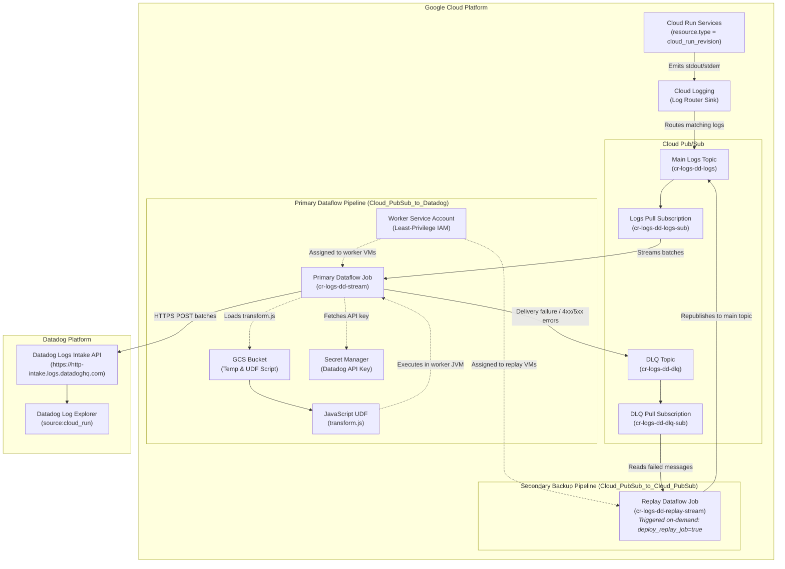

# Production-Grade Cloud Run Log Routing to Datadog via Terraform

This repository provides an enterprise, production-ready Terraform configuration for streaming Google Cloud Run logs to **Datadog** using Google Cloud Logging, Pub/Sub, Secret Manager, Cloud Storage, and Google Cloud Dataflow.

It implements the patterns outlined in the official Google Cloud Architecture Guide:
[**Stream logs from Google Cloud to Splunk**](https://docs.cloud.google.com/architecture/stream-logs-from-google-cloud-to-splunk), adapted and modernized for **Datadog** log intake with a **secondary Dataflow backup pipeline to replay failed messages** without data loss.

---

## 1. Architecture Overview

### Comparison: Splunk Reference Architecture vs. Datadog Production Architecture

| Dimension | Google Architecture (Splunk) | Datadog Production Setup (This Repository) |
|---|---|---|
| **Log Source** | GCP Logs (Cloud Run, Compute, etc.) | Google Cloud Run revisions (and optional Jobs) |
| **Log Router Sink** | Cloud Logging Sink with filter `resource.type="cloud_run_revision"` | Cloud Logging Sink with dynamic service filtering, severity threshold, and unique writer identity |
| **Primary Buffer** | Cloud Pub/Sub Topic + Subscription | Cloud Pub/Sub Topic + Subscription (`cr-logs-dd-logs`) |
| **Primary Pipeline** | Dataflow (`Cloud_PubSub_to_Splunk`) | Dataflow (`gs://dataflow-templates/latest/Cloud_PubSub_to_Datadog`) |
| **Log Intake API** | Splunk HTTP Event Collector (HEC) | Datadog Logs HTTP Intake API (`https://http-intake.logs.<site>`) |
| **Dead-Letter Handling** | Unprocessed Pub/Sub Topic & Subscription | Dead-Letter Queue (DLQ) Topic & Subscription (`cr-logs-dd-dlq`) |
| **Backup / Replay Pipeline** | Pub/Sub to Pub/Sub streaming pipeline | Secondary Dataflow Pipeline (`Cloud_PubSub_to_Cloud_PubSub`) triggered on-demand via `deploy_replay_job = true` |
| **UDF Transformation** | JavaScript UDF for unnesting replayed messages and tallying delivery attempts | JavaScript UDF (`udf/transform.js`) detecting replayed events, cleaning error fields, incrementing `delivery_attempt`, and adding Datadog metadata |
| **Credential Security** | Plaintext / KMS parameter | Google Secret Manager (`SECRET_MANAGER` integration) |
| **IAM Model** | Broad project-level roles | Resource-level, least-privilege IAM bindings for primary & replay pipelines |
| **Zero-Loss Deletion** | Manual drain | Automated `on_delete = "drain"` for both pipelines |

---

### End-to-End Architecture Flow (Primary Stream & Backup Replay Loop)



---

## 2. Key Production Features

1. **Enterprise Resiliency & Backup Replay Loop**:
   - **Dead-Letter Queue (DLQ)**: Undeliverable messages (e.g., HTTP 4xx/5xx errors, network timeouts, invalid payloads) are safely published to the DLQ topic and retained for 7 days in the DLQ subscription without blocking incoming logs.
   - **Secondary Replay Pipeline**: Implements the official Google Cloud recommendation using `gs://dataflow-templates/latest/Cloud_PubSub_to_Cloud_PubSub`. When an operator fixes the root cause of a delivery failure, the replay pipeline moves the backlog from the DLQ subscription back into the primary logs topic for re-ingestion.
   - **Drain on Delete**: Both primary and replay Dataflow pipelines are configured with `on_delete = "drain"`, ensuring all buffered messages are processed before worker VMs are terminated.

2. **JavaScript UDF for Replay Detection & Payload Handling**:
   - The primary Dataflow pipeline executes a custom JavaScript User-Defined Function (`udf/transform.js`) staged in Cloud Storage.
   - **Replay Detection & Unnesting**: Inspects incoming messages to detect if they are replayed from the DLQ (e.g. unnesting `obj.event` or `obj.data` and stripping transient error attributes like `errorMessage` and `errorTimestamp`).
   - **Delivery Attempt Tracking**: Increments `event.delivery_attempt` and flags `event.is_replayed = true`. In Datadog, operators can query `@delivery_attempt:>1` or `@is_replayed:true` to monitor delivery resilience.

3. **Security & Least-Privilege IAM**:
   - **Secret Manager Storage**: Datadog API keys are stored in Google Secret Manager and consumed directly by Dataflow workers (`apiKeySource = "SECRET_MANAGER"`). Credentials are never exposed in plaintext job configurations or console logs.
   - **Strict Resource-Level IAM**: The dedicated Dataflow Worker service account is granted granular permissions:
     - `roles/pubsub.subscriber` & `roles/pubsub.viewer` on `cr-logs-dd-logs-sub`
     - `roles/pubsub.publisher` on `cr-logs-dd-dlq`
     - `roles/pubsub.subscriber` & `roles/pubsub.viewer` on `cr-logs-dd-dlq-sub` (for replay)
     - `roles/pubsub.publisher` on `cr-logs-dd-logs` (for replay)
     - `roles/storage.objectAdmin` on the Dataflow staging bucket
     - `roles/secretmanager.secretAccessor` on the Datadog API key secret
     - `roles/dataflow.worker` on the project

4. **Private VPC & Cloud NAT Compatibility**:
   - Supports `dataflow_worker_ip_configuration = "WORKER_IP_PRIVATE"` with VPC/subnetwork parameters so Dataflow workers run with no public IPs in restricted enterprise networks.

---

## 3. Project Structure

```
log-router-cloud-run-datadog/
├── main.tf                    # Provider config, project data, locals, and required GCP APIs
├── logging_sink.tf            # Cloud Logging sink with dynamic filtering and unique writer IAM
├── pubsub.tf                  # Main topic & subscription, DLQ topic & subscription
├── storage.tf                 # GCS bucket for Dataflow temp files and UDF staging
├── secret_manager.tf          # Secret Manager secret for Datadog API key
├── iam.tf                     # Least-privilege IAM service account and role bindings
├── dataflow.tf                # Primary Datadog streaming job + Secondary Replay job
├── udf/
│   └── transform.js           # JavaScript UDF for replay unnesting and delivery tracking
├── scripts/
│   └── build_and_push.sh      # Helper build and push script for container images
├── cloud-run.tf               # Cloud Run service deployment (optional)
├── variables.tf               # Strongly-typed input variables with validations and defaults
├── outputs.tf                 # Exported resource IDs, endpoints, and pipeline states
├── versions.tf                # Terraform and provider version constraints
├── terraform.tfvars.example   # Sample production configuration file
└── README.md                  # Comprehensive architecture and operations guide
```

---

## 4. Quickstart Guide

### Prerequisites

- Terraform `>= 1.5.0`
- Google Cloud SDK (`gcloud`) authenticated with permissions to create resources (`roles/owner` or `roles/editor` + `roles/resourcemanager.projectIamAdmin`)
- A target Google Cloud Project ID
- A Datadog API Key

### Step 1: Configure Variables

Copy the example configuration:
```bash
cp terraform.tfvars.example terraform.tfvars
```

Edit `terraform.tfvars`:
```hcl
project_id      = "my-production-gcp-project"
region          = "us-central1"
resource_prefix = "prod-cr-datadog"

# Datadog settings
datadog_site    = "datadoghq.com" # or "datadoghq.eu", "us3.datadoghq.com", "us5.datadoghq.com"
datadog_api_key = "YOUR_DATADOG_API_KEY"

# Optional Cloud Run filtering (leave empty to ship logs from ALL services)
cloud_run_service_names = []

# Keep replay pipeline disabled during normal operations
deploy_replay_job = false
```

### Step 2: Initialize & Review Plan

```bash
terraform init
terraform plan -out=tfplan
```

### Step 3: Deploy

```bash
terraform apply tfplan
```

Terraform provisions:
1. All required GCP APIs.
2. The Secret Manager secret storing the Datadog API key.
3. The GCS bucket and uploads `udf/transform.js`.
4. The primary Pub/Sub topic (`prod-cr-datadog-logs`) and DLQ topic (`prod-cr-datadog-dlq`).
5. Dedicated worker service account with least-privilege IAM roles.
6. The Cloud Logging sink targeting the primary Pub/Sub topic.
7. The primary Dataflow streaming pipeline (`prod-cr-datadog-stream`).

---

## 5. Operations: How to Replay Failed Messages (Backup Pipeline SOP)

When the primary pipeline encounters an unrecoverable failure (e.g. invalid Datadog API key, expired secret, network route misconfiguration), failed events accumulate in the DLQ subscription (`prod-cr-datadog-dlq-sub`).

Follow this operational standard operating procedure (SOP) to replay failed messages:

### Step 1: Detect Backlog & Inspect Failed Messages

Monitor the Pub/Sub metric `subscription/num_undelivered_messages` on the DLQ subscription.
Inspect a sample of failed messages:
```bash
gcloud pubsub subscriptions pull prod-cr-datadog-dlq-sub \
  --project=my-production-gcp-project \
  --limit=5 \
  --auto-ack=false
```

### Step 2: Fix the Underlying Root Cause
> **CRITICAL:** Always fix the root cause *before* triggering the replay pipeline. Running the replay pipeline while the root cause persists will create an infinite loop of failures.
- **Invalid API Key**: Update the Secret Manager secret version payload.
- **Wrong Datadog Site**: Verify `datadog_site` matches your Datadog organization datacenter.
- **Network Egress**: Verify Cloud NAT is active if using private worker IPs.

### Step 3: Trigger the Replay Pipeline
In `terraform.tfvars`, enable the replay pipeline:
```hcl
deploy_replay_job = true
```

Apply the configuration:
```bash
terraform apply -target=module.replay_job
# or run a full plan and apply:
terraform apply
```

This launches the secondary Dataflow job (`prod-cr-datadog-replay-stream`), which continuously pulls messages from `prod-cr-datadog-dlq-sub` and writes them into `prod-cr-datadog-logs`.

### Step 4: Monitor Drainage in Cloud Console
1. In Cloud Console, navigate to **Pub/Sub** > **Subscriptions** > `prod-cr-datadog-dlq-sub`.
2. Monitor **Unacknowledged messages** until the count drops to **0**.
3. In Datadog Log Explorer, search:
   ```text
   source:cloud_run @is_replayed:true
   ```
   Verify that replayed logs are successfully indexed and that `@delivery_attempt` reflects `2` or higher.

### Step 5: Decommission the Replay Pipeline
Once the DLQ backlog is fully drained, disable the replay pipeline to avoid idle VM worker charges:
In `terraform.tfvars`:
```hcl
deploy_replay_job = false
```

Apply the changes:
```bash
terraform apply
```

Dataflow cleanly drains any remaining in-flight messages and terminates the replay worker VMs.

---

## 6. Verification in Datadog

Open your Datadog account:
1. Navigate to **Logs** > **Explorer**.
2. Useful queries:
   - **All Cloud Run logs**:
     ```text
     source:cloud_run
     ```
   - **Filter by Cloud Run service**:
     ```text
     source:cloud_run service:sample-cloud-run-app
     ```
   - **Identify replayed logs**:
     ```text
     source:cloud_run @is_replayed:true
     ```
   - **Analyze delivery attempts**:
     ```text
     source:cloud_run @delivery_attempt:>1
     ```

---

## 7. Inputs & Outputs Reference

### Key Input Variables

| Name | Type | Default | Description |
|---|---|---|---|
| `project_id` | `string` | *(Required)* | The Google Cloud Project ID. |
| `region` | `string` | `"us-central1"` | GCP region for regional resources. |
| `resource_prefix` | `string` | `"cr-logs-dd"` | Prefix applied to all resource names. |
| `datadog_site` | `string` | `"datadoghq.com"` | Datadog site domain (`datadoghq.com`, `datadoghq.eu`, etc.). |
| `datadog_api_key` | `string` | `""` | Datadog API Key (stored in Secret Manager). |
| `existing_secret_version_id` | `string` | `""` | Optional reference to an existing Secret Manager secret version. |
| `cloud_run_service_names` | `list(string)` | `[]` | Filter specific Cloud Run services (empty captures all). |
| `include_cloud_run_jobs` | `bool` | `false` | Include Cloud Run Jobs (`resource.type = cloud_run_job`). |
| `log_min_severity` | `string` | `"DEFAULT"` | Minimum severity threshold (DEBUG, INFO, WARNING, ERROR, etc.). |
| `dataflow_machine_type` | `string` | `"n1-standard-2"` | Compute Engine machine type for Dataflow workers. |
| `dataflow_max_workers` | `number` | `4` | Maximum Dataflow autoscaling worker limit. |
| `dataflow_worker_ip_configuration` | `string` | `"WORKER_IP_PUBLIC"` | Worker IP mode (`WORKER_IP_PUBLIC` or `WORKER_IP_PRIVATE`). |
| `dataflow_on_delete` | `string` | `"drain"` | Behavior upon job deletion (`drain` or `cancel`). |
| `enable_udf` | `bool` | `true` | Deploy and attach JavaScript UDF for replay decoding and delivery attempt tracking. |
| `deploy_replay_job` | `bool` | `false` | Deploy the secondary Dataflow replay pipeline to move failed messages from DLQ to main topic. |
| `replay_max_workers` | `number` | `2` | Maximum worker instances for the replay pipeline. |

### Key Outputs

| Name | Description |
|---|---|
| `log_sink_name` | Name of the Cloud Logging Log Router Sink. |
| `log_sink_writer_identity` | Dedicated service account generated by Cloud Logging to publish logs. |
| `pubsub_logs_topic_name` | Name of the primary Pub/Sub topic. |
| `pubsub_logs_subscription_id` | Resource ID of the pull subscription consumed by the primary Dataflow job. |
| `pubsub_dlq_topic_name` | Name of the Dead-Letter Queue (DLQ) topic. |
| `pubsub_dlq_subscription_id` | Resource ID of the DLQ subscription for inspecting and replaying failed messages. |
| `dataflow_job_id` | Unique ID of the primary Dataflow streaming job to Datadog. |
| `dataflow_worker_service_account_email` | Dedicated IAM service account attached to Dataflow workers. |
| `datadog_intake_url` | Target Datadog HTTPS logs intake endpoint. |
| `udf_staging_location` | Cloud Storage URI of the staged JavaScript UDF. |
| `replay_job_deployed` | Status flag showing if the secondary replay job is active. |
| `replay_dataflow_job_id` | Unique ID of the replay Dataflow job (when deployed). |

---

## 8. Teardown

To cleanly destroy all provisioned infrastructure without data loss:
```bash
terraform destroy
```

> **Note**: Because both `dataflow_on_delete = "drain"` and `replay_on_delete = "drain"` are enabled by default, Dataflow will finish processing all queued messages before shutting down worker VMs.
